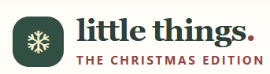

  

  <h3>Make a little list. Share a little magic.</h3>

  
A private Christmas wishlist for two, built for thoughtful gifts, cozy traditions, and the joy of giving.

  <a href="https://littlethings-ke3q.onrender.com/"><strong>Open the wishlist</strong></a>
  · <a href="#getting-started">Getting started</a>
  · <a href="#how-it-works">How it works</a>

  

    
    
    
    
  

---

## 🎄 About Little Things

Little Things began with a simple idea: Christmas shopping should feel personal, not complicated. Instead of sending screenshots, scattered links, or separate notes, couples can keep their holiday wishes together in one cozy space.

Each couple gets their own private wishlist, accessible from either partner's device. Create an account, connect with a single invitation code, and start planning Christmas together.

## ✨ Features

| Feature | Description |
| --- | --- |
| 🎁 Individual wishlists | Keep track of what each partner would love to receive. |
| 💚 Shared wishes | Plan matching gifts, holiday dates, and experiences together. |
| 🔗 Couple pairing | Connect two accounts using a private, single-use invitation code. |
| 💸 Gift budget | Estimate total gift costs and see how much remains in your budget. |
| 🛍️ Gift organization | Add product links, prices, categories, priorities, and helpful notes. |
| ✅ Shopping checklist | Mark gifts as purchased and revisit checked-off items. |
| ❄️ Christmas countdown | Count down the days until December 25. |
| ☁️ Cross-device sync | Access your shared list on different devices, with updates checked every five seconds. |
| 📦 Import & export | Back up your wishlist or append gifts from an existing export. |

## 💌 How it works

1. **Create an account** using your email and password.
2. **Create a wishlist** and copy your unique invitation code.
3. **Share the code** privately with your partner.
4. **Connect** when your partner signs in with their own account and joins using the code.
5. **Make Christmas magical** by adding gifts, setting a budget, and planning holiday memories together.

The invitation code expires after seven days and can only be used once. Both partners can access the wishlist afterward by signing in, without needing the code again.

## 🛠️ Built with

- **HTML, CSS & JavaScript** — responsive Christmas-themed interface, with no build step.
- **Supabase Auth** — individual email/password accounts.
- **Supabase PostgreSQL** — persistent couples, membership, and gift records.
- **Row-level security** — database access is restricted to the members of each couple.
- **GitHub Pages** — static website hosting.

## 🔒 Privacy & data

- Each account can join one couple, and each couple can have at most two partners.
- Database policies restrict gift records and settings to that couple's members.
- Both partners can edit their shared wishlist and budget; the purchased status is visible to both.
- Invite codes are single-use and expire after seven days. Do not post them publicly.
- Old browser-local wishes are not uploaded automatically. Export them from the original version and import the backup into the shared list through Couple settings.

Before inviting users beyond a test couple, verify sign-in, pairing, synchronization, and access isolation with separate test accounts.

---

  
Made with care for the little things that make Christmas special. ♡

  <a href="https://github.com/AN8170">@AN8170</a>

